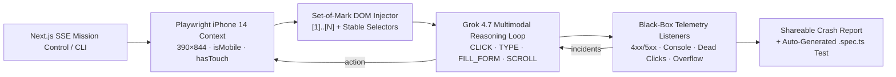

# CHAOS QA // Autonomous Vision & Telemetry Bug-Hunter Agent

[](https://www.typescriptlang.org/)
[](https://nextjs.org/)
[](https://playwright.dev/)
[](https://x.ai/)

Autonomous mobile Chaos QA that **sees** the page, **acts** through Set-of-Mark badges (never guessed coordinates), and **records** black-box telemetry into shareable crash reports + CI-ready Playwright specs.

---

## The Problem & Solution

Traditional E2E suites are brittle: selectors rot, happy-path scripts miss dead UI, and “green” CI still ships broken checkout buttons.

Naive coordinate-guessing AI agents are worse — they click empty pixels, miss overlays, and cannot export reproducible tests.

**Chaos QA** uses **Set-of-Mark (SoM) Visual Prompting + Dual-Selector Resolution**:

1. Inject red numbered `[1]…[N]` badges onto visible interactive elements.
2. Compute a permanent `stableSelector` (`#id`, `[data-testid]`, `name`, `:has-text()`, or CSS path) for every mark.
3. Send the annotated screenshot + interactive map to **Grok Vision**.
4. Execute `CLICK` / `TYPE` / `FILL_FORM` / `SCROLL_DOWN` via `data-chaos-id`, never `(x, y)`.
5. Listen for dead clicks, HTTP 4xx/5xx, console/page crashes, and mobile overflow.
6. Persist a shareable crash report + auto-generated `.spec.ts` under `public/runs/[runId]/`.

---

## Demo Video

> 🎥 https://github.com/user-attachments/assets/4975ea3c-c33f-482a-b579-98ae6eb604f8


> 🎥 https://github.com/user-attachments/assets/7c2246fc-8b8a-47fa-aa48-0f48876531aa

---

## Architecture



---

## 5 Classes of Caught Bugs

| Class | What we detect | Why it matters |
| --- | --- | --- |
| **Dead Click Detection** | Click produces no URL change and &lt;15 DOM delta | Inert CTAs / fake buttons that waste conversion |
| **Silent HTTP 4xx/5xx Interception** | `fetch` / `XHR` / document responses ≥400 + failed requests | Broken APIs users never see in UI copy |
| **Uncaught Page/Console Exceptions** | `pageerror` + `console.error` | Runtime crashes that “look fine” in screenshots |
| **Mobile Viewport Overflow** | `scrollWidth > innerWidth` on 390px | Horizontal bleed that destroys mobile trust |
| **Multi-Field Form Fuzzing** | Single-step `FILL_FORM` with edge-case values + submit | Login/checkout forms exercised without burning 1 step/field |

---

## 3 Operating Modes (Quickstart)

### Prerequisites

```bash
npm install
npx playwright install chromium
```

Create `.env.local`:

```bash
XAI_API_KEY=your_xai_key_here
# optional
XAI_MODEL=grok-4.7
```

### 1) Live Mission Control Web UI

```bash
npm run dev
```

Open [http://localhost:3000](http://localhost:3000), paste a URL + mission, and stream SoM screenshots, Grok thoughts, and live incidents.

### 2) Visual CLI Hunter

```bash
npm run hunt -- "https://www.saucedemo.com" "Login, add a product to cart, and reach checkout"
```

Runs headed Chromium (`headless: false`) with colorized step logs and prints the local report URL.

### 3) Batch Cold-Outreach Lead Scanner

Edit `targets.txt` (one URL per line), then:

```bash
npm run batch
```

Audits every target (`maxSteps: 6`, headless), ranks by HIGH-weighted bug score, and writes `LEADS.md` with an executive table + ready-to-copy cold outreach per site.

Optional custom targets file:

```bash
npm run batch -- ./my-targets.txt
```

---

## Project Layout

```text
src/
  agent/          # mission loop, SoM injector, telemetry
  app/            # Mission Control UI + SSE APIs + crash report page
  lib/            # Grok client + Playwright exporter
  batch.ts        # lead-gen scanner → LEADS.md
  cli.ts          # headed single-site hunter
  types/chaos.ts  # shared contracts
public/runs/      # per-run screenshots, .webm, report.json (gitignored)
targets.txt       # batch URL list
```

---

## Notes

- Playwright is externalized via `serverExternalPackages: ["playwright"]` so Next.js does not bundle browser binaries.
- Run artifacts live under `public/runs/[runId]/` and are served directly by Next (`/runs/...`).
- `LEADS.md`, `.env*`, and `public/runs/*` are gitignored — only `public/runs/.gitkeep` is kept.

Built for founders, QA leads, and engineers who want **vision-grounded** mobile bug hunting with **exportable regressions**, not vibes.
